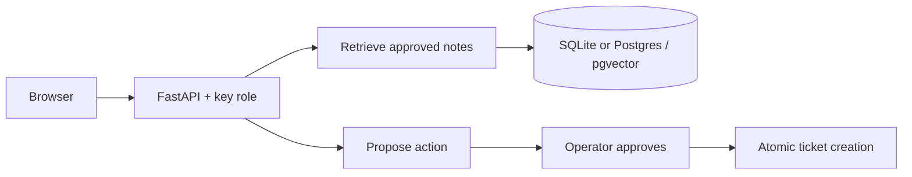

# FieldDesk

[](https://github.com/apoorvkumarvcd23-coder/fielddesk/actions/workflows/tests.yml)

A small service-desk prototype that finds cited operating instructions and
requires operator approval before creating a ticket. Designed for a campus
equipment desk: a user asks about a broken projector, finds the relevant note,
and proposes a repair request without letting a chatbot execute arbitrary actions.

**Python · FastAPI · SQLite · optional PostgreSQL/pgvector · plain HTML/JS**

## Try it locally

Python 3.12+. No model account, GPU or paid API is required.

```sh
python -m venv .venv
# Windows: .venv\Scripts\activate
# macOS/Linux: source .venv/bin/activate
python -m pip install -r requirements-dev.txt
python manage.py keys
python manage.py seed
python run.py
```

Open **http://127.0.0.1:8101**. Copy `FIELDDESK_USER_KEY` from your ignored `.env`
into the access-key field. Ask **"How do I request a projector repair?"** and
inspect the source quotes. Propose a ticket, switch to the operator key, load
the operator queue and approve it. Repeating approval returns the same ticket.

Interactive API documentation: http://127.0.0.1:8101/docs. Use
`Authorization: Bearer <your-key>` on protected endpoints.

## Implemented

- Synthetic manual ingestion with content-hash deduplication.
- Deterministic 256-dimensional hashed bag-of-words retrieval with source IDs,
  titles and exact excerpt citations. Answers are extractive, not LLM-generated.
- Explicit human handoff and no-answer behavior.
- Separate user/operator keys; only operators ingest manuals or approve actions.
- Idempotent proposals, conflicting-key rejection, approval expiry and atomic
  ticket creation. Concurrent approvals create one ticket.
- Trace IDs, outcomes and elapsed time without storing chat text or keys.
- Local browser interface and automated failure/concurrency tests.



## PostgreSQL / pgvector

SQLite is the zero-setup default. Its vectors are JSON and ranked in Python.
The PostgreSQL adapter stores `vector(256)` and runs exact cosine-distance
queries in PostgreSQL. Neither path pretends hash embeddings understand meaning.

```sh
docker compose up -d --wait
```

Add this line to `.env`, substituting the generated `POSTGRES_PASSWORD`:

```text
DATABASE_URL=postgresql://fielddesk:<your-generated-password>@127.0.0.1:5438/fielddesk
```

Run `python manage.py seed` and `python run.py` again. The health endpoint reports
`pgvector`. Keep `.env` private. `docker compose down` stops the optional DB.

## Tests

```sh
python -m pytest -q
```

Tests cover authentication/role boundaries, citations, unknown questions,
instruction-like document content, idempotent/conflicting proposals, concurrent
approval, expiry, missing tickets, trace privacy and persistence after restart.
CI runs SQLite and the real PostgreSQL/pgvector adapter. Locally, setting
`TEST_DATABASE_URL` runs the adapter suite against a **disposable** database;
tests truncate its four application tables. Never use a personal database.

## Scope and tradeoffs

This is a **single-workspace local prototype**, not the complete future project
on the resume. The default path has no LLM, neural semantic embeddings, React,
tenant isolation, external ticket provider or production deployment. Handoff is
a UI response, not a staffed helpdesk. Keyword checks are not a general prompt
injection defense; document text cannot execute tools in this implementation.
Keys are shared role credentials, not individual identity or enterprise IAM.
Production needs identity/tenancy, rotation, quotas, migrations, retention and
deployment hardening. Large-document chunking and ANN tuning are future work.

The next meaningful experiment is a learned embedding/model adapter evaluated
against the same questions, not adding more frameworks. No quality, latency or
adoption improvements are claimed without measurements.

Synthetic fixtures only. No PwC, Stillwater or customer material is included.
