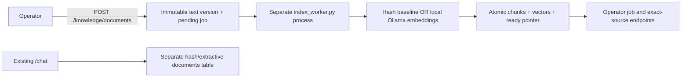

# Versioned indexing foundation (CORE02)

This slice implements ingestion, durable jobs and ready chunk indexes. It does
not yet connect learned vectors to `/chat`, generate cited model answers or
replace shared bearer keys with identity/document grants. The current browser
continues to use the original offline corpus. New knowledge routes are operator
only until the document authorization slice is implemented.



## Clean, isolated demonstration

Install `requirements-dev.txt` in a Python 3.12+ virtual environment. The SQLite
demonstration uses a temporary database and synthetic text; it ignores `.env` and
all configured application databases. It ingests over the actual API, terminates
a claiming worker process, expires the lease, starts a new worker, checks exact
replay and builds a replacement while retaining the previous ready index.

```sh
python demo_indexing.py
```

With Docker running, this creates and stops its own uniquely named PostgreSQL/
pgvector container. It generates a transient database password internally, binds
only a random loopback port, and never attaches to a personal database:

```sh
python demo_indexing.py --postgres
```

Both commands use the labelled hash adapter. CI runs them as process-level
regressions in addition to the SQLite/PostgreSQL pytest jobs. Test adapters and
mocked transports are not real-model evidence.

## Explicit local-model setup and actual inference

Start the installed Ollama server, then download the public embedding model:

```sh
ollama serve
# Another terminal; model download is an explicit step (about 274 MB):
ollama pull nomic-embed-text:v1.5
python probe_local_models.py
python demo_indexing.py --postgres --backend ollama
```

The adapter permits only a local loopback HTTP server. It sends at most eight
600-character source chunks per call, uses the nomic `search_document:` prefix,
disables silent truncation, applies HTTP timeouts and validates vector count,
width and finite values. It verifies the installed model digest before and after
inference. Registration probes the actual vector width; a changed model digest
creates a different space and cannot silently consume old jobs/vectors.

The 9 November IST run is preserved in
[`model-readiness-2026-11-09.json`](model-readiness-2026-11-09.json) and
[`indexing-demo-2026-11-09.json`](indexing-demo-2026-11-09.json). It used Ollama
0.17.7, nomic-embed-text:v1.5 (768 dimensions) and PostgreSQL 17.11/pgvector on
Windows with an RTX 4070 Laptop GPU. Two actual embeddings had unit norms. The
real index demo stored four chunks per version at width 768, recovered a worker
process that exited with code 23, and completed exact replay/replacement checks.

An optional generation readiness probe was also executed against an already
installed `qwen3.5:9b` model. It returned `READY` for the fixed synthetic prompt,
with context 2048, temperature 0, seed 7 and a 32-token output budget. Digests,
actual token counts and observed duration are in the report. This is a smoke
check of inference availability, not a RAG answer-quality result or a latency
benchmark. To reproduce it, first explicitly install that model if needed:

```sh
python probe_local_models.py --generation-model qwen3.5:9b
```

No paid endpoint, external document service or private source is used. A smaller
generation model may be needed on other hardware; it requires a new recorded
probe and later answer/citation evaluation.

## Use the worker with the application

Follow the README's environment/key setup and start `python run.py`. The API and
worker must use the same `DATABASE_URL` (SQLite default or PostgreSQL). They use
the existing ignored `.env`; neither command prints credentials.

```sh
python index_worker.py register-space
python index_worker.py run
# For the actual local embedding space, in place of the hash worker:
python index_worker.py register-space --backend ollama
python index_worker.py run --backend ollama
```

`register-space` prints the space ID, model digest and measured dimensions.
Registration/setup may call the local model. Ingestion itself makes no model
calls: an operator sends this body to `POST /knowledge/documents` using the API
docs at `/docs` and their local operator bearer credential:

```json
{
  "source_key": "projector-manual",
  "title": "Synthetic equipment instructions",
  "body": "Projector repair requests require an approved operator ticket.",
  "space_id": "<64-character ID returned by register-space>"
}
```

Omit `space_id` for the hash space. The response is 202 with a stable job ID.
Use `GET /knowledge/jobs/{id}` for pending/running/ready/failed state and counts,
`GET /knowledge/documents/{document_id}` for desired/ready version pointers, and
`GET /knowledge/versions/{version_id}/chunks?space_id=...` for ready source spans.
`GET /knowledge/spaces` lists registered metadata. All require operator access;
user/anonymous requests are denied. Lease tokens are never returned by the API.

`python index_worker.py once` processes at most one eligible job. `--no-env`
disables `.env` loading for explicit environment-driven tools and isolated demos.

## Persistence, retries and boundaries

- Text is limited to 20,000 characters. Accepted text, including edge whitespace,
  is preserved exactly. Offsets count Unicode characters, not bytes/tokens.
  Fixed windows use 600 characters with 80 overlap; versions record that format.
- Stable source keys identify documents. Title/body/content/chunking identify an
  immutable version. Exact replay returns the same job; replaying an old version
  does not move a newer requested target backwards.
- Jobs are unique by version and embedding space. PostgreSQL claims use `FOR
  UPDATE SKIP LOCKED`; SQLite serializes claims with `BEGIN IMMEDIATE`.
- A normal lease lasts 300 seconds. Restarted workers reclaim expired leases.
  Publication checks both the token and deadline, writes all chunks/vectors and
  the ready pointer in one transaction, and cannot replace a newer desired
  version with an older completion. There is no partial ready index on failure.
- The worker attempts a job at most three times with bounded backoff. Status
  records safe error categories, not exception bodies, prompts or credentials.
  Failed jobs stay visible; an operator requeue control is future work.
- The previous ready version stays queryable in its space during replacement.
  The learned-chat slice must filter grants before retrieval and recheck grants/
  revocation when assembling an answer. That functionality is not delivered here.

`storage.py` owns two checked migrations. Migration 1 adopts the original four
tables without deleting their rows; migration 2 adds the knowledge schema. API
and worker startup serialize migration application. Applied checksums must match;
future changes require new migrations. Back up personal demo databases before
upgrading; automated tests use disposable databases only.

Useful checks:

```sh
python -m pytest -q
python evaluate_retrieval.py
```

The original 16 diagnostic results remain unchanged: 9/10 top-1, 4/6 appropriate
unsupported handoffs and 18/18 matching quotes. These diagnose the legacy hash
path; source matching is not a measure of model answer quality.
